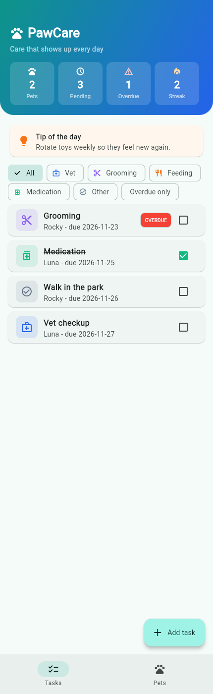
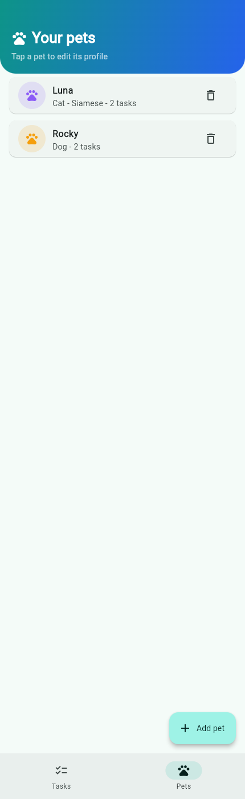

# PawCare

A Flutter app for tracking pet care: pets with profiles, care tasks
(vet visits, grooming, medication) with due dates, and a daily care
streak to keep the habit going.

## Features

- Onboarding screen on first launch with a "Get started" intro.
- Branded teal-to-blue gradient theme with hero headers on both tabs.
- Tasks tab: add, edit and delete tasks per pet, with a category
  (Vet / Grooming / Feeding / Medication / Other) and a due date.
  Each category has its own color and icon.
- Hero stat cards: pets, pending tasks, overdue tasks, and the current
  care streak (with a flame accent once the streak starts).
- Care streak: completing at least one task a day grows the streak;
  it resets when a day is missed.
- Tip of the day: a rotating pet-care tip card.
- Mark a task done; it gets a strikethrough and drops out of the pending
  count. Overdue tasks get a red OVERDUE badge.
- Filters: by category, or overdue only.
- Pets tab: add, edit and delete pets (name, species, breed), each with
  a colored avatar and a live count of its tasks.
- Animated task cards that slide and fade in.
- Friendly empty states.
- Local persistence with shared_preferences, so data survives restarts.
- Input validation: a task needs a title and a valid date; a pet needs a
  name.

## Screenshots





## Tech stack

- Flutter (Material 3) + Dart
- shared_preferences for local storage
- flutter_test widget tests

## Run it

```bash
flutter pub get
flutter run            # on a device/emulator
flutter run -d chrome  # in the browser
```

## Tests

```bash
flutter test
```

9 widget tests cover: the onboarding flow, seeded data/stats/tip card
rendering, the pets tab, adding a task, empty-task rejection, the
overdue filter, starting a streak by completing a task, adding a pet,
and persistence of tasks and onboarding across a restart.
